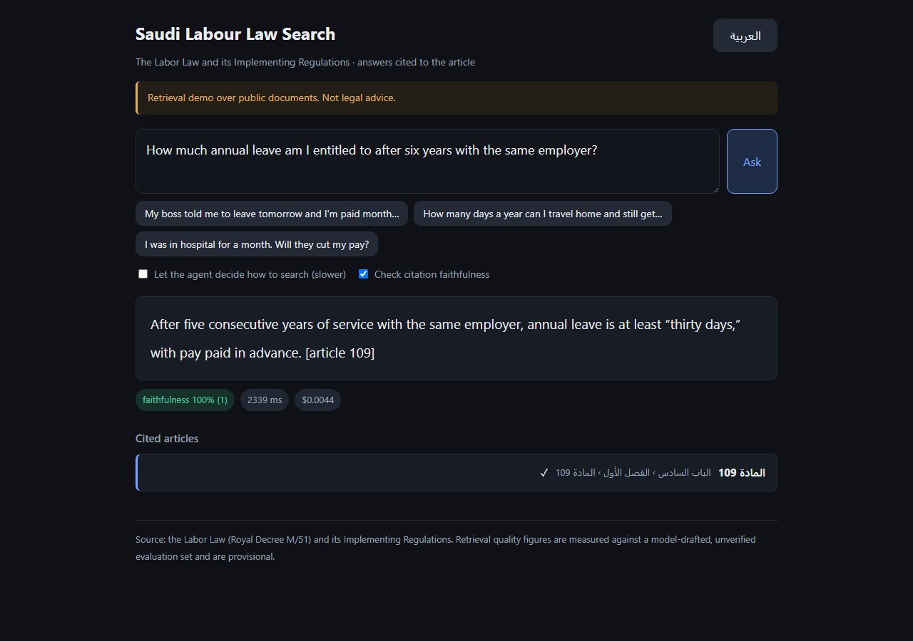

# bilingual-rag

Ask a question about Saudi labour law in Arabic or English, including Gulf
colloquial and common misspellings, and get an answer grounded in the official
text, with the article it came from. When the corpus does not answer the
question, it says so instead of guessing.

| Arabic, RTL | English, LTR |
|---|---|
|  |  |

Both are real screenshots of the running service, reproducible from a URL,
the UI takes `?q=` and `?lang=`, so the exact commands are in *Reproducing
every number* below.

**Look at the left-hand one.** The answer cites two articles, and the service
has flagged **its own second sentence as unsupported by the passage it cites**
faithfulness 50%, with the offending claim printed in red underneath. That
red box is the feature. A system that cannot tell you which of its sentences it
cannot back up is a system you have to check by hand, every time.

## Read this before any number below

**The evaluation set is model-drafted and UNVERIFIED.** It holds 67 questions.
**3 labels have been read by a human** (q024, q025, q033) and **one was
rejected and removed** (q054, minimum wage; its own drafting note flagged that
the Implementing Regulations might cover it). The other **64 have been read by
no one**. Every metric in this README is therefore **provisional**, and none of
it should be described as verified.

Counts differ between runs and both are reported as measured: the
`claude-sonnet-5` answer run covers **68** questions and completed before q054
was rejected; everything else covers the current **67**.

What that means concretely:

| Metric | Depends on the labels? |
|---|---|
| recall@k, MRR, nDCG | **Entirely.** A wrong label turns a correct retrieval into a miss. |
| ablation *differences* | **Partly.** Every configuration is scored against the same labels, so a shared label error largely cancels in the comparison and does not cancel in the absolute number. |
| faithfulness | **No.** It asks whether a claim is supported by the passage the answer cited, checked against retrieved text, not against the label. |
| refusal accuracy | **Entirely**, and there are only 14-15 unanswerable questions depending on the run. |
| citation correctness | **Entirely.** |
| latency, cost | **No.** |

This is enforced, not just promised: every eval script prints the verified
count before any metric and warns when it is zero, every results file carries
`provenance.human_verified`, and `GET /healthz` returns
`"eval_set_verified": false`. See DECISIONS.md, *"Label review was called off"*.

## What it does

- **Hybrid retrieval**: BGE-M3 dense embeddings and BM25, fused with
  reciprocal rank fusion, then reranked by a `bge-reranker-v2-m3`
  cross-encoder.
- **Arabic that actually works**: one normalizer governs both indexing and
  querying: NFKC, tashkeel and tatweel removal, alef and yaa unification,
  Arabic-Indic digit folding. Article numbers written as Arabic ordinal
  *words* (`المادة الخامسة والسبعون`) are parsed to `75`, and the
  Regulations' bracketed `المادة )15( مكرر` to `15_bis`.
- **Grounded answers with citations**: every claim cites the article it came
  from, and a citation to an article that was never retrieved is detected and
  counted.
- **Refusal**: the model replies with a `NO_ANSWER` sentinel when the passages
  do not contain the answer. Refusal is read from that sentinel, never guessed
  from phrasing.
- **A faithfulness check**: each claim in the answer is checked against its
  cited passage by a cheap model.
- **An RTL web UI**, a JSON API, SSE streaming, Prometheus metrics, and a
  Compose deployment.

## Corpus

| | |
|---|---|
| Documents | 2: نظام العمل (BOE HTML) and اللائحة التنفيذية (HRSD PDF) |
| Articles recovered | 248 |
| Chunks indexed | 561 |
| Embedding | `BAAI/bge-m3`, 1024-d |
| Reranker | `BAAI/bge-reranker-v2-m3` |

Two other corpus candidates were **rejected** for silent corruption: a PDF
that extracted with letters reversed and joined incorrectly, and one whose
article numbering did not survive extraction. `scripts/check_corpus_quality.py`
runs five checks and is the reason those were caught before they became
"unexplained retrieval quality". See DECISIONS.md.

## Retrieval: the ablation

53 answerable questions, 3 repeats, `top_k=10` fixed on every row so recall@10
means the same thing on each line.

| Configuration | recall@10 | Δ | MRR@10 | nDCG@10 | p95 latency |
|---|---|---|---|---|---|
| dense only, no normalization | 0.557 | n/a | 0.274 | 0.331 | 36 ms |
| + Arabic normalization | 0.585 | +0.028 | 0.293 | 0.352 | 33 ms |
| + BM25 hybrid with RRF | 0.415 | -0.170 | 0.185 | 0.236 | 31 ms |
| + cross-encoder reranking | 0.623 | +0.208 | 0.339 | 0.401 | 380 ms |

Deltas are against the row above. The noise threshold is 0.02 (about one
question in 53), so `+0.028` for normalization is just outside it and the rest
are well outside.

**Retrieval is deterministic**, so the standard deviation of recall across the
three repeats is 0.000 on every row: the repeats vary latency, not results.
Three repeats therefore buy a latency distribution and nothing else, and the
recall figures should be read as single measurements on 53 questions, an
interval on that would be roughly ±0.13 wide, which is wider than two of the
three deltas.

**The BM25 row is a regression, and it is published as one.** Adding the BM25
hybrid costs 0.170 recall. It was investigated before being reported: equal
RRF weighting explains about 0.13 of it, BM25 alone scores 0.123, and 73% of
query terms are out of vocabulary for the BM25 index. Weighted RRF and a
smaller BM25 candidate pool were both tried and neither recovered it. The
hybrid is still in the default path because the cross-encoder more than
recovers the loss and the failure is understood; the honest summary is that on
*this* corpus BM25 contributes nothing but candidates the reranker has to sort
out. See DECISIONS.md, *"The BM25 -0.170 investigated"*.

**The cross-encoder is what earns its keep**: +0.208 recall, +0.155 MRR, for
about 350 ms.

## Answer quality

68 questions, one pass, `claude-sonnet-5` answering and `claude-haiku-4-5`
checking claims.

| Metric | Value | What it means |
|---|---|---|
| **Faithfulness** | **0.922** | 107 of 116 claims are supported by the passage they cite. Claim-weighted across the whole run, not the mean of per-answer rates. |
| **Refusal accuracy** | **1.000** | 15 of 15 unanswerable questions were correctly declined. Fifteen questions cannot distinguish 1.00 from 0.85; read it as "no observed failures", not as perfection. |
| **False refusal rate** | **0.189** | 10 of 53 answerable questions were declined anyway. **This is the worst number here**: see below. |
| **Citation correctness** | **0.660** | 35 of 53 answerable questions cited an article the eval set marks as governing. |
| **Hallucinated citations** | **0** | No answer cited an article that was never retrieved. |
| p50 / p95 latency | 10.2 s / 30.9 s | End to end, including retrieval, reranking, answering and the faithfulness check. |
| Cost | $1.62 | For all 68 questions, $0.024 each. |

### The false-refusal rate, split by cause

The headline 18.9% is two different failures added together, and
`eval/diagnose_refusals.py` separates them. Retrieval is deterministic, so the
passages each refused question was shown can be recovered exactly, no model
call, no cost.

| Of the 10 refusals | n | What it means |
|---|---|---|
| **retrieval miss**: the article was never shown to the model | 5 | Refusing was **correct**. The defect is retrieval. |
| **over-cautious**: the article was in front of it | 5 | The real answer-layer defect. |

| | claude-sonnet-5 | gpt-5.6-terra |
|---|---|---|
| Reported false refusal rate | 0.189 (10/53) | 0.340 (18/53) |
| **Corrected** (over-cautious ÷ retrieval succeeded) | **0.139** (5/36) | **0.250** (9/36) |

**And the number the headline was hiding is the worse one.** The same split
shows that **17 of the 53 answerable questions (32%) never had the governing
article retrieved at all**, and that Sonnet **answered 12 of those 17 anyway**:

| | claude-sonnet-5 | gpt-5.6-terra |
|---|---|---|
| Answered without the labelled article | **12/53 = 0.226** | 8/53 = 0.151 |
| Refused when the article was missing | 5/17 | 9/17 |

So the more useful-looking model is the one more willing to answer from
passages that do not contain the governing article. **Faithfulness does not
catch this**: it stayed at 0.922, because faithfulness asks whether each claim
is supported by the passage the answer *cited*, and those answers cited
something real, just not the article the question was about.

That is the strongest argument in this repo for reporting citation correctness
(0.660) next to faithfulness (0.922) rather than either alone. A system can be
faithful to the wrong document all day.

**What this changes about what to fix.** Not the answer prompt first: 32% of
answerable questions are a retrieval problem, and the answer layer's own defect
is 13.9%, not 18.9%. Both numbers still rest on unverified labels: a wrong
label makes a correct retrieval look like a miss, so the ordering is a
hypothesis this repo can now state precisely rather than a conclusion.

### The same set, on the other provider### The same set, on the other provider

The answering and claim-checking models are a **model set** in `config.yaml`,
selected with `BILINGUAL_RAG_MODEL_SET` or `--model-set`, so this is one flag
rather than an edit. Both runs, same corpus, same retriever, same prompts.

| Metric | `claude-sonnet-5` + `claude-haiku-4-5` | `gpt-5.6-terra` + `gpt-5.6-luna` |
|---|---|---|
| questions | 68 | 67 |
| faithfulness | **0.922** | 0.817 |
| refusal accuracy | 1.000 | 1.000 |
| false refusal rate | **0.189** | 0.340 |
| citation correctness | **0.660** | 0.585 |
| hallucinated citations | 0 | 0 |
| p50 latency | 10.2 s | 4.0 s |
| cost per question | $0.0239 | **$0.0068** |

Sonnet wins every quality column; terra is **3.5x cheaper and 2.5x faster**.
The gap that matters is the false refusal rate: terra declines 34% of
answerable questions against Sonnet's 19%, on identical retrieved passages. It
is more cautious than the prompt asks it to be, and on a help desk that is felt
as "the system never knows anything".

Neither run's numbers separate a refusal caused by bad retrieval from one
caused by an over-cautious model, for the reason given above: with 64 of 67
labels unread, those two explanations are not yet distinguishable.

## What it costs to run

Measured, not estimated. Two full runs of the same 53 answerable + unanswerable
question set, one per model set. The breakdown below comes from the
`gpt-5.6-terra` run, which is the one instrumented per call; the
`claude-sonnet-5` run predates that instrumentation and its **total** is
measured while its split is not, so no split is given for it.

### Per question, measured

| Component | Cost per question | Share | What drives it |
|---|---|---|---|
| Retrieval (embed, BM25, RRF, rerank) | **$0.000000** | n/a | Local models. No API call. Its cost is machine time: p50 1,209 ms, p95 1,498 ms on an RTX 3060 Ti. |
| Answer generation | **$0.006679** | 98.9% | One call per question. 2,764 input + 96 output tokens. |
| Faithfulness check | **$0.000075** | 1.1% | One call per *claim*, $0.000084 each, 0.90 claims per question over the run. |
| **Total** | **$0.006754** | | `gpt-5.6-terra` answering, `gpt-5.6-luna` checking. |

The same set on the Anthropic model set (`claude-sonnet-5` + `claude-haiku-4-5`)
cost **$0.023857 per question**, measured as a total over 68 questions.

**The single most useful number here is that answer generation is 82.8% input
tokens.** The call sends ten retrieved passages and gets back three sentences:
2,764 tokens in, 96 out. Every intuition about "make the answer shorter" is
aimed at 17% of 99% of the bill.

### Monthly, projected

Straight multiplication of the measured per-question cost. No volume discount,
no caching, no batch pricing assumed.

| Questions / month | `gpt-5.6-terra` | `claude-sonnet-5` |
|---|---|---|
| 1,000 | $6.75 | $23.86 |
| 10,000 | $67.54 | $238.57 |
| 100,000 | $675.40 | $2,385.74 |

**Plus the machine.** Retrieval is GPU-bound and free of API charges, so its
cost is whatever the GPU costs. At the measured p50 of 1.209 s per query, one
RTX 3060 Ti-class GPU serves about **2,978 questions per hour**, so 100,000
questions per month is **33.6 GPU-hours**, under 5% utilisation of a
month's 730 hours. At volumes below roughly 300,000 questions a month the GPU
bill is dominated by idle time, not by queries, and the honest way to write
that line is *the rate you pay for a GPU instance, times 730*, not a number
this repo can measure for you.

The quality difference is not free, and it is in the same tables above:
`claude-sonnet-5` scored faithfulness 0.922 against 0.817, and a false refusal
rate of 0.189 against 0.340. **3.5x the price bought roughly half the false
refusals.** Whether that trade is worth it is a product decision, not an
engineering one, and this README's job is to make it arithmetic rather than
argument.

### Levers, in order of how much they actually move

1. **Retrieve fewer passages.** `top_k` is 10 and input tokens are 82.8% of
   spend. Halving it to 5 removes roughly 40% of the total bill. It also costs
   recall, recall@5 is 0.576 against recall@10 of 0.623, so this is a
   measured trade, and both numbers are in this README.
2. **Use a cheaper model for the answer.** `gpt-5.6-luna` is 10x cheaper per
   token than `gpt-5.6-terra`. Its quality in the answering role has **not been
   measured here**, and swapping it in without re-running the answer eval would
   be exactly the kind of unmeasured claim this repo avoids. The model set
   machinery exists to make that a one-flag experiment.
3. **Cache answers to repeated questions.** Not implemented. In a labour-law
   help desk the question distribution is heavily repeated, so this is likely
   the largest real-world saving and the least interesting engineering.
4. **Provider-side prompt caching.** The system prompt is short next to ten
   passages, so the ceiling here is small: the passages differ per question
   and are the expensive part.
5. **Turn off the faithfulness check.** Saves **1.1%**. It is listed because
   the intuition that a per-claim check must be expensive is wrong and worth
   correcting: it runs on a cheap model, over one short claim and one short
   passage, 0.90 times per question. This is the last thing to cut, not the
   first.

## Retrieval quality

The full pipeline (dense + BM25 + RRF + cross-encoder) over the 53
answerable questions.

| Metric | Value |
|---|---|
| recall@1 | 0.179 |
| recall@5 | 0.576 |
| recall@10 | 0.623 |
| hit@10 | 0.660 |
| MRR@10 | 0.339 |
| nDCG@10 | 0.401 |
| p50 / p95 latency | 1039 ms / 1250 ms |

recall@1 of 0.179 against recall@10 of 0.623 says the
governing article is usually somewhere in the ten, and usually not first. That
is the shape you want for a system that shows a model ten passages; it is not
the shape you want for a "top result" UI, and this one does not have one.

**Where it fails, by topic.** These are small groups: an interval on n=3 is
wider than the differences, but the pattern is consistent enough to name.

| Category | n | recall@10 | MRR@10 |
|---|---|---|---|
| category:annual_leave | 8 | 0.312 | 0.115 |
| category:contracts | 6 | 0.667 | 0.208 |
| category:employment | 2 | 0.500 | 0.100 |
| category:end_of_service | 2 | 1.000 | 0.500 |
| category:leave | 3 | 0.167 | 0.167 |
| category:maternity | 5 | 0.500 | 0.422 |
| category:notice_period | 4 | 0.250 | 0.125 |
| category:rest_days | 3 | 1.000 | 0.511 |
| category:sick_leave | 3 | 1.000 | 0.750 |
| category:termination | 10 | 0.650 | 0.268 |
| category:training | 1 | 1.000 | 1.000 |
| category:working_hours | 6 | 1.000 | 0.672 |

Leave and annual-leave questions are the weak point, and both are dominated by
situational, colloquial phrasing about accrual and carry-over. Working hours,
sick leave and rest days recover the article every time. No claim is made about
why until the labels have been checked; with 64 of 67 labels unread, "the
retriever is bad at leave questions" and "the leave labels are wrong" are not
yet distinguishable.

## Running it

```bash
make setup      # venv, dependencies, corpus download and quality checks
make ingest     # build the Qdrant collection, the BM25 index, and the un-normalized sibling
make serve      # API + RTL UI on http://127.0.0.1:8080
```

Needs a running Qdrant (`docker compose up -d qdrant`) and, for answers,
`ANTHROPIC_API_KEY` in `.env`. Retrieval and the ablation need no API key.

```bash
make test              # 124 tests, no network, no models, no Qdrant
make test-integration  # needs Qdrant and an ingested corpus
make eval              # retrieval metrics
make ablate            # the ablation table above
make answers           # answer quality. COSTS MONEY (~$1.60)
make deploy            # Qdrant + API in containers
```

**A note on the container build.** It builds from the **parent** directory,
because this repo depends on `agent-core` as a local path and `pip` inside the
image cannot resolve a `[tool.uv.sources]` entry. `docker compose` handles that
via `context: ..`, so `make deploy` works as written; a bare `docker build .`
from inside this directory does not, and the Dockerfile says so at the top.
This was found by running the build, not by reading it: see DECISIONS.md,
*"The container build was broken, and the README claimed it worked"*.

**Verified end to end on 2026-08-23**: image builds (521 MB), both containers
start, the corpus ingests inside the container, and `GET /healthz` returns
`chunks_indexed: 561` on the `cpu` profile. A `/search` for *مدة الإشعار*
returns the same articles as the GPU host, 78, 76, 34, 75, 109, from a
`multilingual-e5-base` index rather than a `bge-m3` one, which is the
collection-per-model design working: all three collections coexist in the same
Qdrant and neither run can read the other's vectors by accident.

## API

| Route | |
|---|---|
| `POST /ask` | question → grounded answer, citations, refusal flag, faithfulness |
| `POST /ask/stream` | the same, as server-sent events, so the UI shows the stage rather than a spinner |
| `POST /search` | retrieval only, no model call, no cost, no possibility of a hallucinated answer |
| `GET /articles/{n}` | the article's own text |
| `GET /healthz` | profile, models, chunk count, **and the eval-set provenance flag** |
| `GET /metrics` | Prometheus: requests, refusals, hallucinated citations, spend |

## Hardware profiles

The embedder and the cross-encoder do not both fit in 8 GB of VRAM, so the
retriever loads them in sequence and the profile is chosen at startup from what
is actually present:

| Profile | Chosen when | Candidates reranked |
|---|---|---|
| `cuda_large` | ≥ 16 GB VRAM | 50 |
| `cuda_small` | CUDA, < 16 GB | 30 |
| `mps` | Apple silicon | 30 |
| `cpu` | no accelerator | 20 |

Measured on this machine: `cuda_small`, RTX 3060 Ti, 8.6 GB.

## Dialect routing (optional, repo 04)

Set `DIALECT_SERVICE_URL` and `/ask` attaches the question's dialect, from
[arabic-nlp-platform](../arabic-nlp-platform). Verified live on 2026-08-23:

| Question | Route | Dialect | Confidence |
|---|---|---|---|
| `شو بدي اعمل اذا صاحب العمل ما دفعلي معاشي؟` | `dialect` | LB | 0.998 |
| `طلعوني من الشغل فجاه بدون ما يخبروني قبل بمده` | `default` | n/a | 0.562 |
| `نعم` | `default` | n/a | 0.334 |
| *(service unreachable)* | `default` | n/a | n/a |

**The second row is the interesting one, and it is the classifier being
correct.** Repo 04's classes are Egyptian, Libyan, Lebanese, Sudanese and
Moroccan. There is no Gulf class, and Gulf colloquial is exactly what most of
this corpus's questions are written in. So on repo 02's real traffic the router
abstains more often than it fires, which is the confidence floor doing its job
rather than forcing a question into the nearest wrong bucket.

That is also the honest limitation: **routing is not currently useful to this
repo**, because the classifier was trained on the dialects an open dataset
provided rather than the one this corpus needs. The integration is real, the
degradation path is tested, and no retrieval improvement is claimed.

## Reproducing every number

Nothing here is quoted from memory. Each row names the command and the file the
number is read out of.

| Number | Command | Raw data |
|---|---|---|
| Corpus size, articles, chunks | `make ingest` | `data/ingest_report.json` |
| Ablation table | `make ablate` | `eval/results/ablation.json` |
| Retrieval quality, per-category | `make eval` | `eval/results/retrieval.json` |
| Answer quality, both providers | `make answers` and `make answers BILINGUAL_RAG_MODEL_SET=openai` | `eval/results/answers.json`, `answers_openai.json` |
| Cost breakdown per call | same run as above | the `*_cost_usd` and `*_tokens` fields |
| False-refusal split by cause | `make refusals` | `eval/results/*_refusal_split.json` |
| Test counts | `make test`, `make test-integration` | stdout |
| Lint and types clean | `make lint`, `make typecheck` | stdout |
| Container deployment | `make deploy`, then `curl localhost:8080/healthz` | stdout |
| The two screenshots | `make serve`, then the two URLs below | `docs/ui_ar.png`, `docs/ui_en.png` |

```
http://127.0.0.1:8080/?lang=ar&q=طلعوني من الشغل فجاه بدون ما يخبروني قبل بمده، لي شي عندهم؟
http://127.0.0.1:8080/?lang=en&q=How much annual leave am I entitled to after six years with the same employer?
```

**What costs money:** `make answers` only, about $1.62 on the Anthropic model
set and $0.45 on the OpenAI one. Retrieval, the ablation, the refusal split and
every test are free and need no API key: the refusal split in particular is
free precisely because retrieval is deterministic, which is the whole reason
that analysis was possible at all.

## Design notes

Every real choice between alternatives is in [DECISIONS.md](DECISIONS.md) with
the evidence that decided it, including the ones that went badly:

- an eval set that turned out not to discriminate at all, and the two earlier
  conclusions it voided;
- a BM25 hybrid that **hurts** recall on this corpus by 0.170, investigated
  rather than quietly dropped;
- a `use_normalization` ablation flag that was inert, it re-embedded the same
  index, and the un-normalized sibling index built to make it mean something;
- the query never being normalized at all, which is the single most common
  Arabic-search bug and was live in this code;
- three eval labels marked `verified_by: human` by a piped shell command that
  no human read.

## Not done

- **The labels.** 64 of 67 unread. Everything above is provisional until that
  changes.
- **The BM25 regression.** Weighted RRF and a smaller BM25 candidate pool were
  tried; neither recovered it. 73% of query terms are out of vocabulary for the
  BM25 index, which is the leading explanation and is not yet proven.
- **Cross-lingual retrieval** is measured only through English questions
  against the Arabic corpus; the translation path is implemented but not
  ablated separately.
